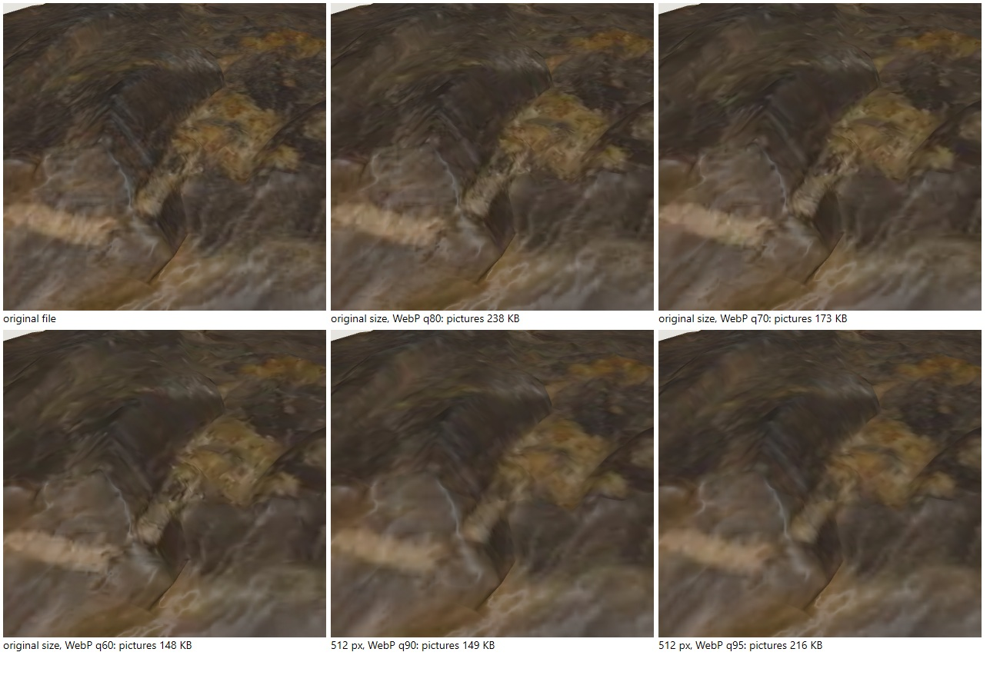
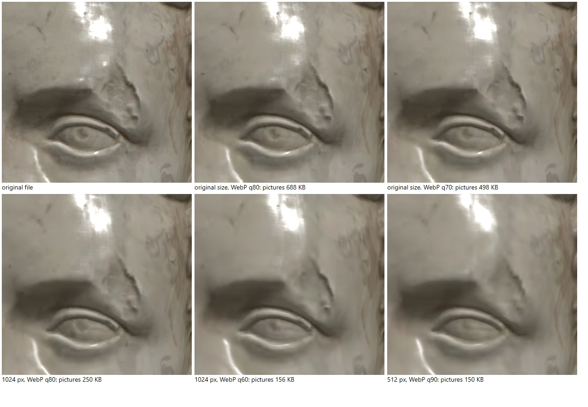

# Model import, direction 1, round 3: a quality slider for the pictures

The third round of [direction 1](../model-import-1-guided-steps/README.md)
("make a 3D model lighter" as two guided steps plus an optional far-away
step). Everything [round 2's README](../model-import-4-guided-steps-r2/README.md)
says still holds unless this one says otherwise; round 2 stays as it was, so
the two can be opened side by side. The samples are loaded from the earlier
folders, as in round 2.

## What changed, and why

- **The rock's step from its original 1024 px pictures to 512 px was too
  large to look at.** Halving the side is the only step a power-of-two
  ladder has, so this round adds a finer control in the same step instead of
  more sizes: first choose the size, then lower the quality until a close-up
  looks worse than the original.
- **One "Picture quality" slider under the size buttons**, from 40 % to 95 %
  in steps of 5, starting at **80 %**. It is the canvas encoder's quality
  argument for the format in use (WebP, or JPEG when WebP is off).
  - It moves every picture written lossy: colour, bumps and shine alike.
    Round 2 kept bumps and shine at 92 % and colour at 85 %; on both samples
    the bump and shine maps are two thirds of the picture bytes, so a slider
    that left them alone would barely change the file.
  - Pictures with see-through parts stay PNG and are not affected; the note
    under the slider says so when a model has any. A model whose pictures are
    all PNG gets the slider disabled.
  - While it moves: its line reads "80 % · making..." and the chosen size
    button "making...", the pictures are made again once the slider has
    rested for 250 ms (a drag would otherwise queue a full set of encodes per
    value), and then the line shows the measured bytes and the 3D view the
    new pictures. Encodes queued for a quality already left are dropped. If
    an encode fails, the error is shown and the step stays usable.
  - Sizes not made yet keep their "about" estimate, now at the chosen quality
    (the note says so): scaled from the nearest measured version of the same
    picture, nearest in size and in quality, with the measured bytes-against-
    quality curve (`qualityBytes` in `size-model.js`). For the rock at 60 %
    the 512 px estimate read about 52 KB against 50 KB measured.
  - The WebP line compares the two formats at the same size and quality; the
    review lists the quality ("WebP at 80 % quality"); the accepted result
    carries `textureQuality` (0..1).
- **No in-between sizes such as 768 px.** That question stays open: the
  slider is tried first.
- **Unchanged on purpose:** everything else from round 2.

## After the first phone test

The size and quality step held up; the rest got these fixes in place.

- **The load test draws every copy as its own model.** It used to draw all
  copies as one instanced mesh: one draw call, one geometry, which no scene
  of different models would ever get. Now every copy is its own mesh with
  its own geometry, so the graphics chip holds one set of buffers per copy
  and draws one call per copy. The copies share the CPU-side arrays (three.js
  uploads one buffer per attribute object) and the material with its
  pictures, as different models may share pictures. They still follow
  Original / Yours, the triangle slider (made again once it rests for
  300 ms) and the triangle look; switching the test off disposes every copy.
  The counts stay 100, 1000 and 3000; 3000 is meant to be heavy on a phone.
- **The load test frames the whole field of copies** when it turns on (seen
  from at least 35 degrees above), so the frame rate is that of a busy scene
  in view, not of the few copies near a close-up camera. The readout adds
  the draw calls and triangles three.js drew in the last frame
  (`renderer.info.render`). Turning the test off puts the camera back where
  it was.
- **Far away after the load test no longer starts tiny.** The far-away step
  takes the camera's pose as its close view, and the load test left the
  camera far out (zoomed out by hand to see the copies), so the step's whole
  distance range started there. The camera now returns to its pose from
  before the load test whenever the test ends, before the step starts.
- **One viewing distance in the flow state.** The far-away step's distance
  is `viewDistance` in `import-flow.js` (metres, null outside that step):
  the slider and a pinch or wheel both set it, and the camera and the slider
  follow it. The controls hold a gesture to the slider's range. A turn of
  the model is kept when the slider moves.
- **The model never clips.** The near and far planes follow the camera's
  distance on every frame in every step (and take in the field of copies
  while the load test runs), so zooming in no longer cuts the model away.

Frame rates measured on a desktop (Intel Iris Xe, Chrome, 1400 x 900, the
rock at all triangles, half-second readings, median over 8 to 20 s), not on
a phone:

| copies | before: one instanced mesh, close-up camera | after: separate models, whole field framed |
| ------ | ------------------------------------------- | ------------------------------------------ |
| none   | 60                                          | 60                                         |
| 100    | 58                                          | 60 (101 draw calls)                        |
| 1000   | 18                                          | 9 (1001 draw calls)                        |
| 3000   | 7                                           | 4 (3001 draw calls)                        |

## Quality, measured

Every offered size of the rock (three 1024 px JPEG pictures: bumps, colour,
shine; 446 KB of pictures) and the bust (three 2048 px JPEG pictures;
1.23 MB) written at nine qualities in both formats with the browser's canvas
encoder (headless Chromium, the same path as the prototype's helper thread).
Bytes of all three pictures together, in KB.

Rock, WebP:

| size         | 95  | 90  | 85  | 80  | 70  | 60  | 50  | 40  | 30  |
| ------------ | --- | --- | --- | --- | --- | --- | --- | --- | --- |
| 1024 (orig.) | 607 | 415 | 308 | 238 | 173 | 148 | 126 | 106 | 87  |
| 512          | 216 | 149 | 110 | 83  | 58  | 50  | 43  | 36  | 29  |
| 256          | 67  | 46  | 35  | 27  | 19  | 17  | 14  | 12  | 10  |
| 128          | 20  | 15  | 11  | 9   | 7   | 6   | 5   | 5   | 4   |

Rock, JPEG:

| size         | 95  | 90  | 85  | 80  | 70  | 60  | 50  | 40  | 30  |
| ------------ | --- | --- | --- | --- | --- | --- | --- | --- | --- |
| 1024 (orig.) | 611 | 510 | 445 | 410 | 311 | 216 | 201 | 157 | 129 |
| 512          | 261 | 174 | 133 | 110 | 84  | 68  | 58  | 48  | 38  |
| 256          | 77  | 52  | 40  | 33  | 25  | 21  | 18  | 15  | 12  |
| 128          | 23  | 16  | 12  | 11  | 9   | 7   | 6   | 6   | 5   |

Bust, WebP:

| size         | 95   | 90   | 85  | 80  | 70  | 60  | 50  | 40  | 30  |
| ------------ | ---- | ---- | --- | --- | --- | --- | --- | --- | --- |
| 2048 (orig.) | 1806 | 1229 | 890 | 688 | 498 | 434 | 373 | 317 | 266 |
| 1024         | 699  | 464  | 328 | 250 | 182 | 156 | 135 | 114 | 95  |
| 512          | 220  | 149  | 112 | 87  | 64  | 55  | 48  | 41  | 33  |
| 256          | 68   | 48   | 37  | 29  | 22  | 19  | 17  | 14  | 12  |

Bust, JPEG:

| size         | 95   | 90   | 85   | 80   | 70   | 60  | 50  | 40  | 30  |
| ------------ | ---- | ---- | ---- | ---- | ---- | --- | --- | --- | --- |
| 2048 (orig.) | 1858 | 1492 | 1353 | 1192 | 1009 | 851 | 701 | 536 | 438 |
| 1024         | 904  | 607  | 469  | 392  | 303  | 247 | 211 | 177 | 143 |
| 512          | 274  | 185  | 144  | 120  | 93   | 76  | 66  | 55  | 45  |
| 256          | 80   | 55   | 43   | 36   | 28   | 23  | 20  | 17  | 14  |

At the original size, a re-encode that comes out larger than the original
picture keeps the original (the shelf's rule), so in the prototype the
rock's original size shows 446 KB at 95 % in WebP and at 90 and 95 % in
JPEG. With the default, the whole rock file goes from 679 KB to 441 KB
without changing its size (round 2's fixed qualities: 587 KB).

Then the look: close-ups of the 3D view (a quarter of the model's size from
the surface, one texture pixel over several screen pixels) at 95, 90, 80,
70, 60, 50 and 40 % for each measured size, next to the original file.

- **95 to 80 %:** no difference to the original that we could point to;
  the bytes fall fastest here (rock 1024 px WebP: 607 to 238 KB, bust
  2048 px: 1.81 MB to 688 KB).
- **70 %:** fine grain starts to smooth (the rock's yellow patch, the bust's
  surface speckle), the shapes stay; still 27 % fewer bytes than 80 %.
- **60 %:** visible smearing and blotches in WebP, blocks and colour fringes
  in JPEG; each further 10 points saves only about 15 % more.
- **50 and 40 %:** plainly poor in both formats.

**The default is 80 %**: the last value where the close-up still looks like
the original, at the end of the steep part of the byte curve (90 to 80 %
saves about 43 %). **The lower end is 40 %**, where it is plainly poor, so
the whole useful range and a little past it is on the slider. **The upper
end is 95 %**; above 90 % the bytes grow far faster than anything visible
and often pass the original file.

Defensible instead: **70 %** (another quarter off, with a softening an
author may not mind on a rock seen from a metre away), or the shelf's
**85 %** (one value with the app's current colour pictures). Which one wins
depends on what these measurements did not cover: a phone screen at arm's
length shows less than a close-up on a desktop monitor, and the samples are
two scanned models; a model with lettering or sharp painted edges would show
compression sooner.

## Rock: 1024 px at a lower quality against 512 px at a high one

- 1024 px at 60 % (148 KB) and 512 px at 90 % (149 KB) cost the same. The
  512 px picture is clean but blurred everywhere; the 1024 px one keeps the
  edges and cracks but smears the fine grain.
- **1024 px at 70 % (173 KB) is both smaller and sharper than 512 px at 95 %
  (216 KB).** Lowering the quality at full size keeps more of the rock than
  halving the size at full quality, for fewer bytes.
- So for the rock the slider does what an in-between size would have done:
  1024 px at 70 to 80 % sits between the original and 512 px in bytes and
  in look.

The same comparison for the bust:

These two pictures are JPEG screenshots of the 3D view, so they add a little
compression of their own; open the prototype for the real look.

## Files

As in round 2. `size-model.js` adds `PICTURE_QUALITY`, `qualityValues`,
`clampQuality`, `qualityBytes` and a `quality` argument to `textureFormat`;
the flow's choices add `pictureQuality` (percent, snapped to the slider's
steps by the reducer, reset by "keep pictures"). The module API's
`set("pictureQuality", 70)` moves the slider, and `stats().picturesShown`
reads "size|webp|quality", for example "1024|true|80".
